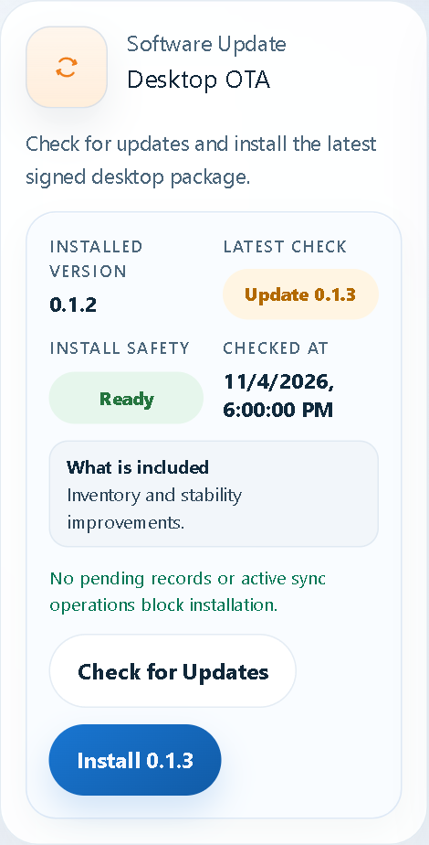
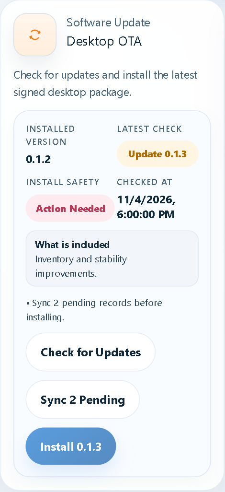

# VPOS Desktop Update Guide

This guide explains how an administrator publishes a signed VPOS Desktop update and how a cashier installs it safely.

## What the update system protects

- Updates replace application files, not branch data.
- Local SQLite records, cached products, printer settings, device setup, and the sync queue remain on the workstation.
- The updater verifies the package using the public key embedded in VPOS Desktop.
- The release process uploads the versioned package first and publishes `latest.json` last, so an incomplete upload cannot be offered to cashiers.

## Part A: One-time administrator setup

### 1. Keep the signing key on the release computer

Store the Tauri updater private key outside the repository, for example:

```text
C:\Secure\TauriUpdater\vpos-desktop-updater.key
```

Do not upload this key to GitHub or the VPS. The VPS only needs signed public release files.

### 2. Confirm the VPS update folder

```bash
sudo mkdir -p /var/www/vpos-desktop-updates
sudo chown -R $USER:$USER /var/www/vpos-desktop-updates
```

The Caddy site must include this handler before the main web handler:

```caddy
handle_path /desktop-updates/* {
  root * /var/www/vpos-desktop-updates
  file_server
}
```

Reload Caddy:

```bash
sudo caddy reload --config /etc/caddy/Caddyfile
```

### 3. Configure the API update policy

Add these values to the production API environment:

```env
DESKTOP_WINDOWS_UPDATES_ENABLED=true
DESKTOP_WINDOWS_LATEST_VERSION=0.1.3
DESKTOP_WINDOWS_MIN_SUPPORTED_VERSION=0.1.1
DESKTOP_WINDOWS_REQUIRED=false
DESKTOP_WINDOWS_ROLLOUT_PERCENTAGE=100
DESKTOP_WINDOWS_RELEASE_NOTES=Inventory and stability improvements.
DESKTOP_WINDOWS_PUBLISHED_AT=2026-11-04T10:00:00.000Z
DESKTOP_WINDOWS_SUPPORT_URL=https://vmjamtech.com/support
```

Use `REQUIRED=false` for normal releases. Raise `MIN_SUPPORTED_VERSION` only when older desktop builds must stop creating new transactions.

## Part B: Publish an update

### 1. Choose the next version

Use a higher semantic version. Example: `0.1.2` becomes `0.1.3`.

From PowerShell in `D:\vpos`:

```powershell
pnpm desktop:version -- 0.1.3
pnpm --filter @vpos/desktop version:check
```

This updates and verifies:

- `apps/desktop/package.json`
- `apps/desktop/src-tauri/tauri.conf.json`
- `apps/desktop/src-tauri/Cargo.toml`

### 2. Commit the release source

```powershell
git add apps/desktop/package.json apps/desktop/src-tauri/tauri.conf.json apps/desktop/src-tauri/Cargo.toml
git commit -m "Release VPOS Desktop 0.1.3"
git push origin main
```

The release tool expects a clean Git working tree so the package can be traced to one commit.

### 3. Set signing secrets for this PowerShell session

```powershell
$env:TAURI_PRIVATE_KEY="C:\Secure\TauriUpdater\vpos-desktop-updater.key"
$env:TAURI_KEY_PASSWORD="<YOUR-PRIVATE-KEY-PASSWORD>"
$env:VPOS_SIGN_CERT_SHA1="<WINDOWS-CODE-SIGNING-CERTIFICATE-SHA1>"
$env:VPOS_SIGN_TIMESTAMP_URL="http://timestamp.digicert.com"
```

The Tauri private key signs the updater package. The Windows certificate signs the installer and improves publisher trust.

### 4. Build without publishing

```powershell
pnpm desktop:release -- -Version 0.1.3 -Notes "Inventory and stability improvements"
```

The command:

1. verifies that the working tree and versions are correct;
2. runs desktop type checks and tests;
3. builds the Windows MSI and updater ZIP;
4. verifies that a signature exists;
5. generates SHA-256 checksums and release metadata;
6. creates `latest.json` locally;
7. stops before uploading.

Test the generated MSI on a non-production workstation before publishing.

### 5. Publish after testing

```powershell
pnpm desktop:release -- -Version 0.1.3 -Notes "Inventory and stability improvements" -Publish
```

The command uploads the immutable `0.1.3` folder, verifies the public artifact URL, and replaces `latest.json` last.

### 6. Update the production policy and API

Set the API policy values to the published version, then update the VPS services:

```bash
cd /opt/vpos
git pull --ff-only origin main
docker compose -f infra/compose/docker-compose.prod.yml up -d --build api
```

If the Compose service is not named `api`, run the normal full update:

```bash
docker compose -f infra/compose/docker-compose.prod.yml up -d --build
```

Verify:

```bash
curl https://vmjamtech.com/api/desktop-updates/policy?platform=windows\&arch=x86_64\&version=0.1.2
curl https://vmjamtech.com/desktop-updates/latest.json
```

## Part C: Install an update on a cashier workstation

### 1. Open Settings

Open VPOS Desktop, select **Settings**, and find **Software Update → Desktop OTA**.

### 2. Check workstation safety

The panel shows the installed version, available version, release notes, and installation safety.



When Install Safety is **Ready**:

1. select **Check for Updates**;
2. review the version and release notes;
3. select **Install**;
4. allow VPOS Desktop to download, verify, install, and restart.

### 3. Sync pending work first

If the workstation has unsynced transactions, installation is disabled.



Select **Sync Pending**, wait until the panel changes to **Ready**, then install the update.

If a cashier shift is open, VPOS warns before installation. Close the shift first when operationally possible.

### 4. Verify after restart

After VPOS Desktop restarts:

1. open **Settings → Desktop OTA**;
2. confirm Installed Version shows the new version;
3. confirm branch, location, printer, and cashier settings remain correct;
4. select **Sync Now**;
5. perform a test print and a small test transaction if this is a pilot workstation.

## Troubleshooting

### Check failed

- Confirm the workstation has internet access.
- Open `https://vmjamtech.com/desktop-updates/latest.json` in a browser.
- Confirm the API policy endpoint returns JSON.
- Confirm the manifest references an existing HTTPS ZIP URL.

### Action Needed

- Select **Sync Pending**.
- Wait for the top status to show **All Synced**.
- Finish any active transaction.
- Retry installation.

### Invalid manifest or signature

- Do not bypass verification.
- Rebuild the same source as a newer patch version.
- Sign it using the same updater key whose public key is embedded in the installed app.
- Publish the version folder before `latest.json`.

### Update needs to be reversed

The desktop configuration disallows downgrades. Publish a newer patch containing the revert—for example, publish `0.1.4` to reverse a problem in `0.1.3`. Keep the previous installers for emergency manual recovery.

## Release record checklist

- [ ] Source commit and tag recorded.
- [ ] Version sources match.
- [ ] Tests and type checks pass.
- [ ] MSI/updater bundle produced.
- [ ] Updater signature present.
- [ ] SHA-256 checksum recorded.
- [ ] Test workstation upgraded successfully.
- [ ] Version folder uploaded.
- [ ] `latest.json` published last.
- [ ] API policy updated.
- [ ] Pilot cashier workstation confirmed healthy.
